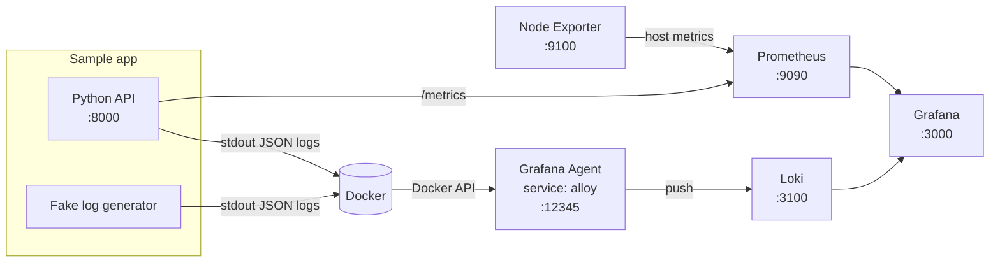

# Pro Monitor - Metrics and Logs with Prometheus, Loki and Grafana

A ready-to-run observability stack built with Docker Compose. A sample Python API exposes metrics and writes structured logs. **Prometheus** collects the metrics, **Loki** stores the logs, and **Grafana** shows both in three pre-built dashboards. A built-in fake log generator means there is always data to explore.

---

## Table of Contents

- [Quick Start](#quick-start)
- [Architecture](#architecture)
- [Prerequisites](#prerequisites)
- [Configuration](#configuration)
- [Management Script (`monitor.sh`)](#management-script-monitorsh)
- [Service Access](#service-access)
- [Grafana Dashboards](#grafana-dashboards)
- [Sample API](#sample-api)
- [Logs](#logs)
- [Alerts](#alerts)
- [Useful Queries](#useful-queries)
- [Customization](#customization)
- [Troubleshooting](#troubleshooting)
- [Project Structure](#project-structure)

---

## Quick Start

```bash
# 1. Create your configuration and set GRAFANA_ADMIN_PASSWORD
cp .env.example .env

# 2. Build and start all services
./monitor.sh start

# 3. Send 1000 requests to the API to populate the dashboards (~10 minutes)
./monitor.sh test 1000

# 4. Open Grafana and go to Dashboards > Monitoring
#    http://localhost:3000  (user/password from .env)

# 5. Stop everything when you are done (data volumes are kept)
./monitor.sh stop
```

> **Windows:** run `monitor.sh` from **Git Bash** or **WSL**. All `docker compose` commands work in PowerShell as well.

---

## Architecture



| Component | Role |
|-----------|------|
| **Sample API** (`sample-app`) | Flask API that exposes Prometheus metrics and writes structured JSON logs |
| **Fake log generator** | Background thread in the API that emits realistic business logs |
| **Prometheus** | Scrapes metrics from the API, Node Exporter, Grafana and itself; evaluates alert rules |
| **Node Exporter** | Host metrics (CPU, memory, disk, network) |
| **Grafana Agent** (`alloy`) | Discovers containers through the Docker API and ships their logs to Loki |
| **Loki** | Log storage, queried with LogQL |
| **Grafana** | Dashboards for metrics and logs, provisioned automatically |

---

## Prerequisites

- Docker with Docker Compose v2 (`docker compose`). The script also accepts the legacy `docker-compose`.
- `curl` (used by `./monitor.sh test`)
- Free host ports: `3000`, `3100`, `8000`, `9090`, `9100`, `12345`. You can change them in `.env`.

---

## Configuration

Every tunable value lives in `.env`, which Docker Compose reads automatically. Copy the template and edit it:

```bash
cp .env.example .env
```

`.env` is git-ignored and only `.env.example` is committed. If `.env` is missing, `./monitor.sh` creates it from the template.

| Variable | Default | Description |
|----------|---------|-------------|
| `GRAFANA_ADMIN_USER` | `admin` | Grafana admin user |
| `GRAFANA_ADMIN_PASSWORD` | **required** | Grafana admin password. It has no default, so Compose refuses to start without it. |
| `COMPOSE_PROJECT_NAME` | `pro-monitor` | Docker Compose project name (prefix for volumes and network) |
| `RESTART_POLICY` | `unless-stopped` | Restart policy for every service |
| `LOG_MAX_SIZE` / `LOG_MAX_FILE` | `10m` / `3` | Container log rotation |
| `APP_VERSION` | `1.0.0` | Sample app version (image tag and log field) |
| `APP_PORT` / `APP_HOST_PORT` | `8000` / `8000` | Sample app container port / host port |
| `FAKE_LOGS_ENABLED` | `true` | Turn the fake log generator on or off |
| `FAKE_LOGS_INTERVAL_SECONDS` | `1.0` | Average seconds between fake log lines |
| `FAKE_LOGS_INCIDENT_EVERY_SECONDS` | `300` | Seconds between simulated error bursts (`0` disables them) |
| `PROMETHEUS_RETENTION` | `200h` | Prometheus TSDB retention |
| `PROMETHEUS_VERSION`, `LOKI_VERSION`, `GRAFANA_AGENT_VERSION`, `GRAFANA_VERSION`, `NODE_EXPORTER_VERSION` | pinned tags | Image versions. They are pinned on purpose, so avoid `latest`. |
| `PROMETHEUS_HOST_PORT`, `LOKI_HOST_PORT`, `ALLOY_HOST_PORT`, `GRAFANA_HOST_PORT`, `NODE_EXPORTER_HOST_PORT` | service default | Host port published for each service |

After changing `.env`, apply it with:

```bash
docker compose up -d
```

---

## Management Script (`monitor.sh`)

```bash
./monitor.sh <command> [argument]
```

| Command | Description |
|---------|-------------|
| `start` | Start all services and print the access URLs |
| `stop` | Stop and remove the containers. **Data volumes are kept.** |
| `restart` | Restart all services |
| `status` (or `ps`) | Show the state of each container |
| `logs [service]` | Follow logs of all services, or of one (`prometheus`, `sample-app`, ...) |
| `build` | Rebuild the images without cache |
| `test [n]` | Send `n` requests to the API endpoints (default `30`) |
| `logs-test` | Ask the API to write a batch of test logs |
| `loki-status` | Check that Loki and the log agent are running |
| `urls` | Print all access URLs |
| `backup` | Copy configuration and data into `backup-YYYYMMDD-HHMMSS/` |
| `clean` | **Delete containers and volumes** (asks for confirmation) |
| `help` | Show the help |

### Common workflows

```bash
# Generate a heavy load to see the dashboards move
./monitor.sh test 1000

# Light smoke test
./monitor.sh test

# Follow the API logs
./monitor.sh logs sample-app

# Stop the stack (keeps metrics, logs and Grafana data)
./monitor.sh stop

# Start it again later with the same data
./monitor.sh start
```

> `./monitor.sh test 1000` spreads requests across `/`, `/health`, `/users`, `/data` and `POST /process`, with a 0.2 s pause between them plus each endpoint's simulated processing time. Expect it to take about **9-10 minutes** (about 0.55 s per request). Watch the **Application metrics** dashboard while it runs, or press `Ctrl+C` to stop early.

---

## Service Access

| Service | URL | Credentials |
|---------|-----|-------------|
| **Grafana** | http://localhost:3000 | `GRAFANA_ADMIN_USER` / `GRAFANA_ADMIN_PASSWORD` from `.env` |
| **Prometheus** | http://localhost:9090 | - |
| **Prometheus alerts** | http://localhost:9090/alerts | - |
| **Sample API** | http://localhost:8000 | - |
| **Loki** | http://localhost:3100 | - |
| **Grafana Agent** | http://localhost:12345 | - |
| **Node Exporter** | http://localhost:9100 | - |

---

## Grafana Dashboards

All dashboards are provisioned into the **Monitoring** folder (**Dashboards > Monitoring**).

### System metrics
Host metrics from Node Exporter: CPU (total and per core), memory, disk usage per mount point, network traffic, load average (1m/5m/15m), disk operations, running and blocked processes, and uptime.

### Application metrics
Sample API metrics: requests per second per endpoint, P50/P95/P99 latency, simulated active users, application memory, and HTTP status codes.

### Application logs
Logs from Loki:

| Panel | Shows |
|-------|-------|
| Total log lines / Warnings / Errors | Counters for the selected time range |
| Error ratio | Errors as a percentage of all app log lines |
| Log volume by level | Stacked INFO / WARNING / ERROR / CRITICAL bars |
| Errors by component | Which component is failing, and when |
| Top warnings and errors | Most frequent problem messages |
| Logs by component | Share of log lines per component |
| Application logs | Live log stream |

Use the variables at the top to filter by **Component**, **Level** or free-text **Search**.

---

## Sample API

| Endpoint | Method | Description |
|----------|--------|-------------|
| `/` | GET | General API information |
| `/health` | GET | Health status and uptime |
| `/users` | GET | User statistics (fails 5% of the time) |
| `/data` | GET | Data processing (10% of requests are slow, 1-2 s) |
| `/process` | POST | Job submission (fails 8% of the time) |
| `/logs` | GET | Writes 5 test logs with random levels |
| `/metrics` | GET | Prometheus metrics |

Exposed metrics:

| Metric | Type | Description |
|--------|------|-------------|
| `http_requests_total{method, endpoint, status}` | Counter | HTTP requests received |
| `http_request_duration_seconds{method, endpoint}` | Histogram | Request duration |
| `api_operations_total{operation, status}` | Counter | Business operations |
| `active_users` | Gauge | Simulated active users |
| `app_memory_usage_bytes` | Gauge | Simulated memory usage |

Try it manually:

```bash
curl http://localhost:8000/
curl http://localhost:8000/users
curl -X POST http://localhost:8000/process
curl http://localhost:8000/metrics
```

---

## Logs

### How logs are collected
The API writes one JSON object per line to stdout. The **Grafana Agent** (service `alloy`, running the agent's static mode, which preceded Grafana Alloy) discovers containers through the Docker API, reads their logs and pushes them to Loki with two jobs:

| Job | Contains | Labels |
|-----|----------|--------|
| `flask-app-logs` | Sample API logs | `job`, `container`, `stream`, `service`, `level`, `component` |
| `docker-logs` | Logs from every container in the stack | `job`, `container`, `stream` |

### Fake log generator
[app/fake_logs.py](app/fake_logs.py) runs inside the API and writes realistic business logs, about one per second, so the logs dashboard always has data.

- **Components:** `auth`, `orders`, `payments`, `inventory`, `notifications`, `search`
- **Events:** logins, failed logins, orders, payments, declined payments, gateway timeouts, slow queries, low stock, notifications and crashes
- **Fields:** `request_id`, `user_id`, `ip_address`, `method`, `endpoint`, `status_code`, `duration`, `region`, plus event-specific fields (`order_id`, `amount`, `error`, ...)
- **Level mix:** about 74% INFO, 18% WARNING, 7% ERROR and 1% CRITICAL
- **Incidents:** every 5 minutes, a burst of 10-25 errors from a single component

Example line:

```json
{"timestamp": "2026-11-24T19:28:11.251488Z", "level": "ERROR", "message": "Payment gateway timeout", "service": "sample-app", "component": "payments", "status_code": 504, "duration": 12.4, "error": "Upstream payment gateway timed out"}
```

Tune or disable it with the `FAKE_LOGS_*` variables in `.env`, then run `docker compose up -d sample-app`.

### Explore logs in Grafana
1. Open http://localhost:3000 and go to **Explore**
2. Select the **Loki** datasource
3. Run any of the LogQL queries below

---

## Alerts

Rules live in [prometheus/rules/alerts.yml](prometheus/rules/alerts.yml). You can see them at http://localhost:9090/alerts.

| Alert | Condition | Severity |
|-------|-----------|----------|
| `HighCpuUsage` | CPU > 80% for 2 min | warning |
| `HighMemoryUsage` | Memory > 85% for 5 min | critical |
| `LowDiskSpace` | Free disk on `/` < 10% for 1 min | critical |
| `ServiceDown` | A scrape target is down for 1 min | critical |
| `HighLatency` | P95 latency > 1 s for 5 min | warning |
| `HighHttpErrorRate` | 5xx responses > 0.1 req/s for 2 min | warning |
| `HighHttpLoad` | > 100 req/s for 3 min | warning |

> Alertmanager is not included, so alerts show up in Prometheus but are not sent anywhere. To route them, uncomment the `alerting` block in [prometheus/prometheus.yml](prometheus/prometheus.yml) and add an Alertmanager service.

---

## Useful Queries

### PromQL (metrics)

```promql
# Requests per second per endpoint
sum by (endpoint) (rate(http_requests_total[5m]))

# P95 latency
histogram_quantile(0.95, sum by (le) (rate(http_request_duration_seconds_bucket[5m])))

# Error percentage (4xx + 5xx)
sum(rate(http_requests_total{status=~"[45].."}[5m])) / sum(rate(http_requests_total[5m])) * 100

# Host CPU usage
100 - (avg(rate(node_cpu_seconds_total{mode="idle"}[5m])) * 100)

# Host memory usage
(node_memory_MemTotal_bytes - node_memory_MemAvailable_bytes) / node_memory_MemTotal_bytes * 100

# Which targets are up
up
```

### LogQL (logs)

```logql
# All API logs
{job="flask-app-logs"}

# Errors only
{job="flask-app-logs", level=~"ERROR|CRITICAL"}

# Payment errors from the fake log generator
{job="flask-app-logs", component="payments", level="ERROR"}

# Slow requests (duration > 1 s)
{job="flask-app-logs"} | json | duration > 1

# Error count per component in 5-minute windows
sum by (component) (count_over_time({job="flask-app-logs", level="ERROR"} [5m]))

# Logs from any container
{job="docker-logs", container="prometheus"}
```

---

## Customization

**Add an API endpoint**
1. Add the route in [app/app.py](app/app.py) with the `@measure_request` decorator
2. Rebuild it: `docker compose up -d --build sample-app`

**Add a dashboard**
1. Design it in the Grafana UI
2. Export it as JSON (**Share > Export**)
3. Save it in `grafana/dashboards/`. It is loaded into the Monitoring folder within 10 seconds.

**Add a scrape target or alert**
1. Edit [prometheus/prometheus.yml](prometheus/prometheus.yml) or [prometheus/rules/alerts.yml](prometheus/rules/alerts.yml)
2. Reload without restarting: `curl -X POST http://localhost:9090/-/reload`

---

## Troubleshooting

| Problem | Solution |
|---------|----------|
| `required variable GRAFANA_ADMIN_PASSWORD is missing a value` | Create `.env` (`cp .env.example .env`) and set the password |
| `port is already allocated` | Change the matching `*_HOST_PORT` in `.env` |
| Dashboards are empty | Wait about 30 s after start, then run `./monitor.sh test 1000` |
| No logs in the logs dashboard | Run `./monitor.sh loki-status` and check that `FAKE_LOGS_ENABLED=true` |
| App code changes are not applied | `docker compose up -d --build sample-app` |
| Start from scratch | `./monitor.sh clean`. This deletes all metrics, logs and Grafana data. |

---

## Project Structure

```
2-pro_monitor/
├── app/
│   ├── app.py                 # Flask API with metrics and structured logging
│   ├── fake_logs.py           # Fake log generator
│   ├── Dockerfile
│   └── requirements.txt
├── alloy/
│   └── alloy-config.yaml      # Grafana Agent log collection config
├── grafana/
│   ├── dashboards/            # api.json, system.json, logs.json
│   └── provisioning/          # Datasources and dashboard provider
├── loki/
│   └── loki-config.yaml       # Loki storage config
├── prometheus/
│   ├── prometheus.yml         # Scrape config
│   └── rules/alerts.yml       # Alert rules
├── .env.example               # Configuration template
├── docker-compose.yml         # Service definitions
├── monitor.sh                 # Management script
└── README.md
```
